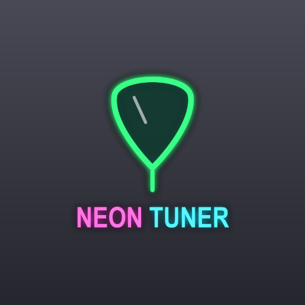
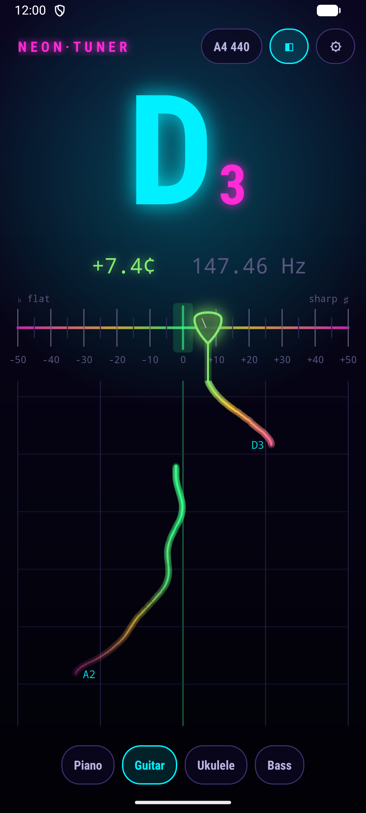
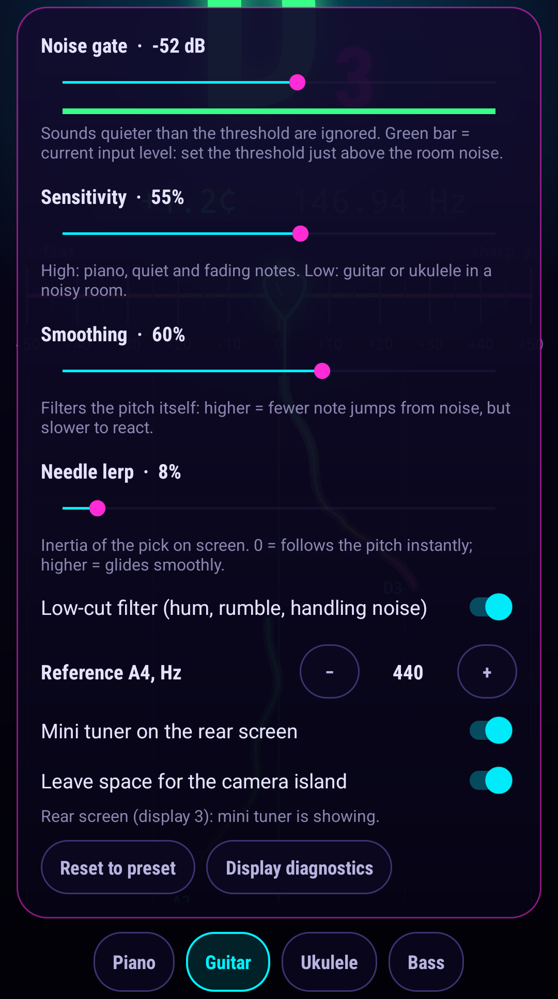
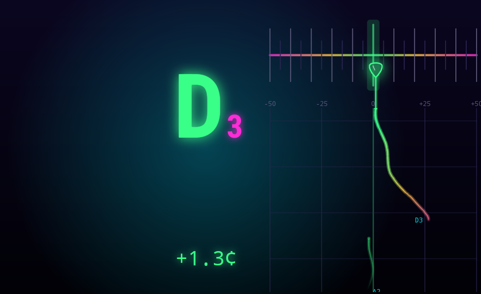

<p align="center">
  
</p>

<h1 align="center">Neon Pick Tuner</h1>

<p align="center">
  Lightweight native Android chromatic tuner with a neon guitar-pick needle and a scrolling pitch waterfall.<br>
  Runs on <b>both screens of the Xiaomi 18 Pro Max</b>, including the HyperOS rear display.
</p>

<p align="center">
  <a href="https://github.com/AndreySkyFoxSidorov/hyperos-neon-pick-tuner/releases/latest"><b>Download the APK</b></a>
  ·
  Kotlin · no third-party libraries · ~100 KB
</p>

---

## Screenshots

| Main screen | Settings |
|:---:|:---:|
|  |  |

**Rear screen (976 × 596).** The left ~30 % is left free for the camera island:



> The screenshots were taken on the Android emulator in demo mode, where a synthetic plucked string goes through the real pitch detector. The rear-screen shot uses a simulated 976×596 display, the same size as the Xiaomi rear panel.

## Features

- **Neon pick needle.** A glowing guitar pick shows how far you are from the note, from −50 to +50 cents. The pick turns green when you are in tune, amber when you are close and magenta when you are far off.
- **Pitch waterfall.** A beam from the pick tip draws the trace, and the trace scrolls down. You can see which way the pitch drifts while you turn the peg, and where each new note started.
- **Accurate detection.** The tuner uses the McLeod Pitch Method on an FFT autocorrelation, with parabolic and multi-period refinement. Unit tests show at most 0.5 cent error from A0 (27.5 Hz) to C8 (4186 Hz).
- **Instrument presets:** Piano (26–4300 Hz, long window, high sensitivity), Guitar, Ukulele and Bass.
- **Noise control:**
  - noise gate with a live input-level meter, so you can set it just above the room noise;
  - low-cut filter for hum, rumble and handling noise;
  - note-stability filter.
- **Settings:** sensitivity, smoothing, *needle lerp* (pick inertia, almost off by default) and the A4 reference (415–466 Hz).
- **Two screens at once.** On the Xiaomi 18 Pro Max a compact tuner runs on the rear display, and both screens stay awake while the app is open.
- **Small.** The release APK is about 100 KB. It uses plain Android Views and the Kotlin stdlib, with no other libraries.

## Install

1. Download `NeonPickTuner-v1.0.0.apk` from [Releases](https://github.com/AndreySkyFoxSidorov/hyperos-neon-pick-tuner/releases/latest).
2. Open it on the phone and allow installing from this source.
3. Grant the microphone permission. The notification permission is optional: the tuner runs as a microphone foreground service.

Requires Android 12 (API 31) or newer.

## HyperOS rear screen: how it works

Xiaomi has no public API for drawing custom content on the rear display. We tested on a **Xiaomi 18 Pro Max** with HyperOS `OS4.0.7.0.XEOEUXM` (EEA, Android 17). On that device the gate is a single manifest flag:

- The rear panel is `displayId 1`: 976×596, internal, `FLAG_PRESENTATION | FLAG_TRUSTED | FLAG_OWN_DISPLAY_GROUP`. It is **not** listed in `DISPLAY_CATEGORY_PRESENTATION`.
- `ActivityStarterImpl.isShouldShowOnRearDisplay` in `/system_ext/framework/miui-services.jar` checks the meta-data key **`miui.rear.policy`**:
  - on the activity: `0` blocks it, `1` allows it;
  - if the activity has no key, the value on the application is used.

  Without the flag the launch is aborted with result code **102** (`should not allow app = … show on rear display`).
- The stock Xiaomi Camera declares `miui.rear.policy = 1`. Neon Pick Tuner does the same for its compact `RearActivity`:

  ```xml
  <activity android:name=".rear.RearActivity" android:exported="true" android:resizeableActivity="true">
      <meta-data android:name="miui.rear.policy" android:value="1" />
  </activity>
  ```

  and starts it with `ActivityOptions.makeBasic().setLaunchDisplayId(rearDisplayId)`. No root, no Shizuku.
- **Windows** from non-system apps are refused on the rear display (`Not allow non-system app add window type = 2037 on rear display`). This covers `Presentation` and `TYPE_APPLICATION_OVERLAY`. On HyperOS only the Activity route works. The other two routes are kept as fallbacks for other dual-screen devices and for the emulator.
- When the rear panel dozes, `com.xiaomi.subscreencenter` puts its clock back on top. While the main app is open, it brings the tuner back every few seconds.

**Display diagnostics** (⚙ → Display diagnostics) lists every display with its flags. It can also show a test "A4" via `Presentation` or launch the tuner on a chosen display. Use it to check other devices or firmware versions.

From a PC you can also start the rear tuner with:

```
adb shell am start --display 1 -n com.neontuner/.rear.RearActivity
```

The original research notes, in Russian, with the Xiaomi docs and community sources (Chinese quotes translated): [docs/rear-screen-research.ru.md](docs/rear-screen-research.ru.md).

## Build

Requirements: JDK 17+ (the Android Studio JBR works) and Android SDK 36.

```
./gradlew assembleRelease          # app/build/outputs/apk/release/app-release.apk
./gradlew testDebugUnitTest        # pitch-detector tests
```

Release signing reads `keystore.properties` from the project root. The file is git-ignored and holds `storeFile`, `storePassword`, `keyAlias` and `keyPassword`. Without it, the release build is signed with the debug key.

Demo mode for UI work (debug builds only):

```
adb shell am start -n com.neontuner/.MainActivity --ez demo true
```

To simulate the rear screen on an emulator:

```
adb shell settings put global overlay_display_devices 976x596/240
```

To regenerate the launcher icon: `java tools/IconGen.java`.

## Project layout

```
app/src/main/java/com/neontuner/
  audio/PitchDetector.kt    MPM pitch detection + FFT
  audio/TunerEngine.kt      AudioRecord loop, noise gate, low-cut, smoothing
  audio/TunerSettings.kt    presets and persisted settings
  ui/TunerView.kt           note, neon pick, scale and waterfall (custom View)
  rear/RearActivity.kt      compact tuner for the rear display (miui.rear.policy=1)
  rear/RearDisplays.kt      rear display lookup + camera-island layout
  rear/DisplayProbeActivity.kt  display diagnostics / Presentation test
  TunerService.kt           microphone foreground service
  MainActivity.kt           main screen + settings
```
